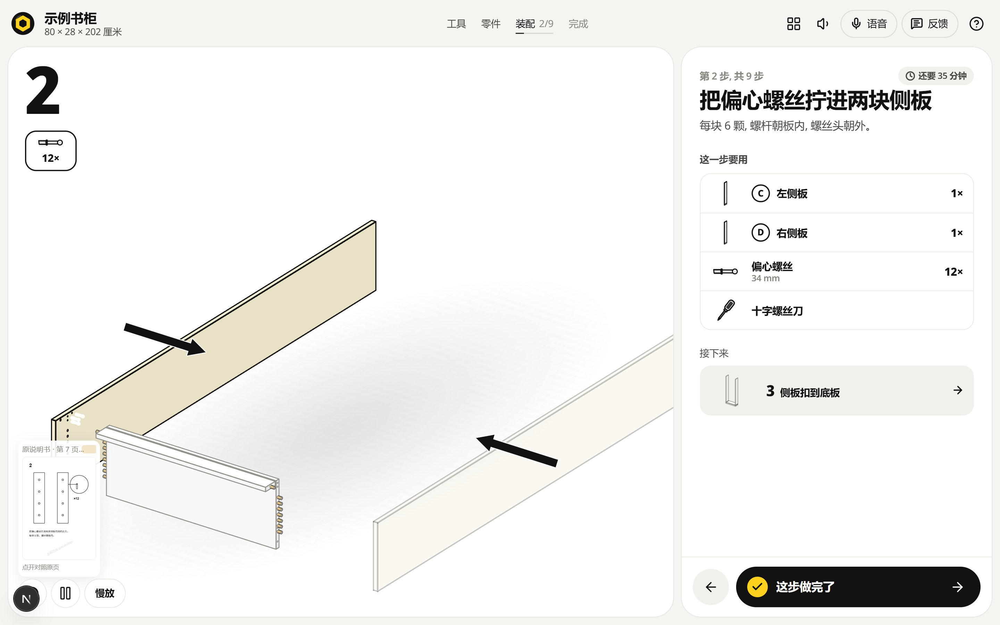
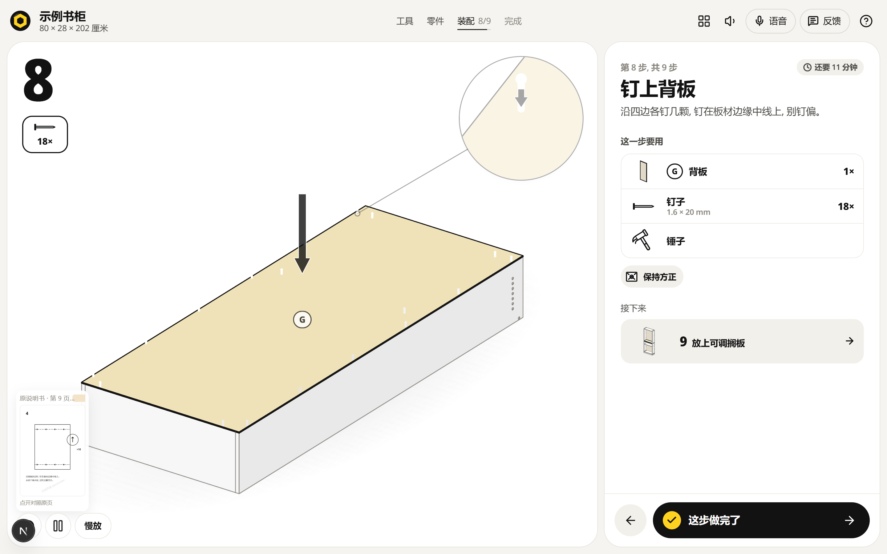

# 3D 装配说明书（assembly-3d-zh）

把一份纸质装配说明书变成可以点的网页 3D 分步演示：每一步有动画、有五金数量，旁边并排显示原说明书同一页。用户既看得到"怎么做"，也看得到"原厂怎么画的"。





## 和上游的关系

这是 [Nutlope/bygga](https://github.com/Nutlope/bygga)（MIT，687★）的 fork。上游已经解决了最难的两块：参数化装配计划（291 个产品族）和 three.js 线稿舞台，还有"拍说明书 → 逐页读 → 结构化 spec → 校验修复"的扫描链路。本项目不重写这些，只补中文场景需要的东西，并保留上游的 `LICENSE` 与 `NOTICE`。

## 这个 fork 加了什么

1. **界面中文化**：导航、步骤面板、零件清单、工具清单、完成页、按钮、读屏提示都换成中文；五金名称（偏心螺丝、木榫、搁板托等）和警告语（保持方正、需要两个人等）也一起改了。
2. **原页对照面板**：`src/components/guide/ManualPage.tsx`，按 `slug + 步骤下标` 找原说明书页，缩略图常驻在画布左下角，点开全屏对照。数据在 `src/data/manual-pages.ts`。
3. **中文示例产品**：`src/data/demo-custom.ts` 是一款九步的书柜，零件、步骤、文案全是中文，直接跑 `/build/demo-bookcase` 就能看到完整的中文体验，不需要任何 API key。
4. **中文手册提示词**：`src/lib/scan/prompts.zh.ts`。`SCAN_LANG=zh` 时扫描链路改用中文提示词读中文说明书，输出的 JSON 结构与英文版完全一致，解析器不用改。

## 快速开始

```bash
npm install
npm run dev
# 中文示例（推荐先看这个）
# http://localhost:3000/build/demo-bookcase
# 上游的 IKEA 目录演示（步骤文案是英文，由上游产品族生成）
# http://localhost:3000/build/billy-80x202?step=3
```

想给任意产品临时挂上演示页（默认关闭，避免占位图出现在正式页面）：

```bash
# Windows PowerShell
$env:NEXT_PUBLIC_MANUAL_DEMO="1"; npm run dev
# macOS / Linux
NEXT_PUBLIC_MANUAL_DEMO=1 npm run dev
```

## 接一款真实产品

1. 把客户手册逐页转成图片，放进 `public/manual-pages/<slug>/`（只放客户拥有版权的页面）。
2. 在 `src/data/manual-pages.ts` 里登记每一步对应第几页：

```ts
"kehu-bookcase-80": {
  brand: "客户品牌",
  name: "两门书柜",
  stepPages: [
    { page: 6, src: "/manual-pages/kehu-bookcase-80/p06.png" },
    { page: 7, src: "/manual-pages/kehu-bookcase-80/p07.png" },
    null,
  ],
}
```

3. 手册没有现成产品族时，有两套路：
   - **手工录入**：照 `src/data/demo-custom.ts` 写一份 `custom`（零件给毫米尺寸与成品中心点，步骤给 title / add / fix），在 `src/lib/catalog.ts` 里挂上 slug 即可。
   - **扫描起草**：设置 `TOGETHER_API_KEY` 与 `NEXT_PUBLIC_SCAN=1`，访问 `/scan` 上传手册页，得到草稿 plan 后人工校正尺寸。

## 已知限制

- 上游 IKEA 目录产品的**步骤文案仍是英文**（由产品族代码生成）；中文步骤来自 `custom` 数据或中文手册扫描。这是下一步要解决的最后一截。
- 原页对照只支持按步骤映射的整页图，还没有自动定位到页内某张分图。
- 扫描链路依赖 Together AI 的 key，国内部署要换成国产 VLM，提示词结构可以直接复用。
- 本仓库不含任何 IKEA 说明书或图纸；演示页是自己画的示意图，界面标"示例"。

## 路线图

- [ ] IKEA 目录产品的步骤文案也走中文（先做标题模板，再补词表）
- [ ] 原页对照支持页内分图定位（点步骤直接高亮原页里对应的那张图）
- [ ] 扫描链路接国产 VLM，出一份中文真实手册的端到端样例
- [ ] 客户手册的版本管理（同一款换版后，步骤与页映射可对比）

## 商业化

这个仓库怎么变成一门生意（客户是谁、怎么报价、单款交付的固定动作、边界），写在 [docs/产品化.md](docs/产品化.md)。

## 许可与商标

代码沿用上游的 MIT（见 `LICENSE`，保留原始版权声明），商标与第三方材料的边界见 `NOTICE`。交付时只能使用客户自己拥有版权的说明书页。
