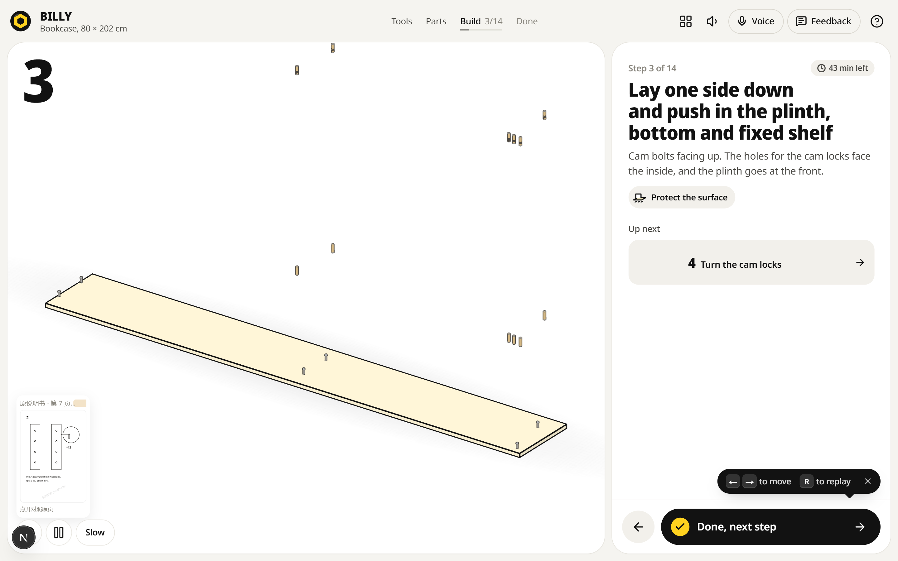
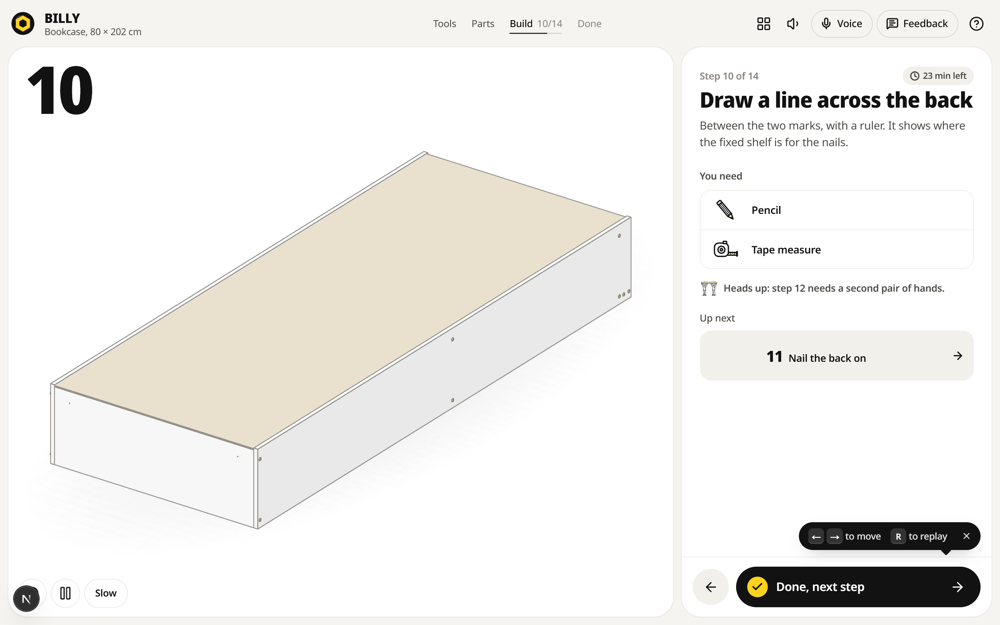

# 3D 装配说明书（assembly-3d-zh）

把客户自己的纸质装配说明书变成可以点的网页 3D 分步演示：每一步有动画、有五金数量，旁边并排显示原说明书同一页，用户既看得到"怎么做"，也看得到"原厂怎么画的"。





## 和上游的关系

这是 [Nutlope/bygga](https://github.com/Nutlope/bygga)（MIT，687★）的 fork。上游已经解决了最难的两块：参数化装配计划（291 个产品族）和 three.js 线稿舞台，还有"拍说明书 → 逐页读 → 结构化 spec → 校验修复"的扫描链路。本项目不重写这些，只做中文场景需要补的部分，并保留上游的 `LICENSE` 与 `NOTICE`。

## 这个 fork 加了什么

1. **原页对照面板**：`src/components/guide/ManualPage.tsx`，按 `slug + 步骤下标` 找原说明书页，缩略图常驻在 3D 画布左下角，点开全屏对照。数据在 `src/data/manual-pages.ts`。
2. **中文手册提示词**：`src/lib/scan/prompts.zh.ts`。`SCAN_LANG=zh` 时扫描链路改用中文提示词读中文说明书，输出的 JSON 结构与英文版完全一致，解析器不用改。
3. **本仓库自己的定位**：站点元信息、README、演示页（自己画的 SVG 示例页，不含任何厂商的说明书）。

## 快速开始

```bash
npm install
npm run dev
# 打开 http://localhost:3000/build/billy-80x202?step=3
```

想看到原页对照面板，需要打开演示开关（默认关闭，生产环境不显示占位页）：

```bash
# Windows PowerShell
$env:NEXT_PUBLIC_MANUAL_DEMO="1"; npm run dev
# macOS / Linux
NEXT_PUBLIC_MANUAL_DEMO=1 npm run dev
```

## 接一款真实产品

1. 把客户手册逐页转成图片，放进 `public/manual-pages/<slug>/`（只放客户拥有版权的页面）。
2. 在 `src/data/manual-pages.ts` 里登记每一步对应第几页：

```ts
"kehu-bookcase-80": {
  brand: "客户品牌",
  name: "两门书柜",
  stepPages: [
    { page: 6, src: "/manual-pages/kehu-bookcase-80/p06.png" },
    { page: 7, src: "/manual-pages/kehu-bookcase-80/p07.png" },
    null,
  ],
}
```

3. 没有现成产品族的新款，用扫描链路起草：设置 `TOGETHER_API_KEY` 与 `NEXT_PUBLIC_SCAN=1`，访问 `/scan` 上传手册页，得到草稿 plan 后再人工校正尺寸。

## 已知限制

- 界面文案仍是英文。中文化是下一步，本轮只做了"中文手册进、原页对照出"。
- 原页对照只支持按步骤映射的整页图，还没有自动定位到页内的某张分图。
- 扫描链路依赖 Together AI 的 key，国内部署要换成国产 VLM，提示词结构可以直接复用。
- 本仓库不含任何 IKEA 说明书或图纸，演示页是自己画的示意图。

## 路线图

- [ ] 界面全量中文化（导航、步骤面板、工具清单、提示语）
- [ ] 原页对照支持页内分图定位（点击步骤直接高亮原页里对应的那张图）
- [ ] 扫描链路接国产 VLM，出一版中文手册的端到端样例
- [ ] 客户手册的版本管理（同一款产品换版后，步骤与页映射可对比）

## 许可与商标

代码沿用上游的 MIT（见 `LICENSE`，保留原始版权声明），商标与第三方材料的边界见 `NOTICE`。交付时只能使用客户自己拥有版权的说明书页。
